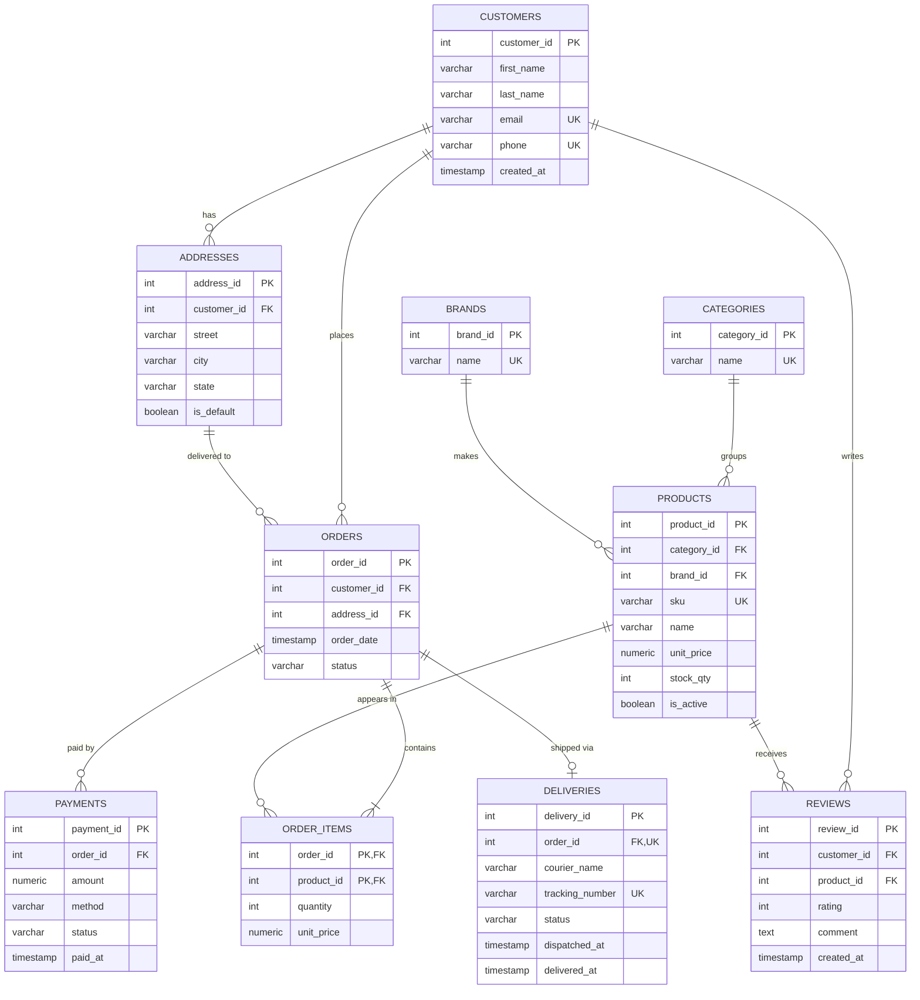

# Portfolio 1: ER Diagram – Muhab Gadget Store

## Relationships

| Relationship | Cardinality | How it is implemented |
|---|---|---|
| Customer – Address | 1 to many | `addresses.customer_id` → `customers` |
| Customer – Order | 1 to many | `orders.customer_id` → `customers` |
| Address – Order | 1 to many | `orders.address_id` → `addresses` |
| Category – Product | 1 to many | `products.category_id` → `categories` |
| Brand – Product | 1 to many | `products.brand_id` → `brands` |
| Order – Product | many to many | resolved by `order_items` (composite PK: order_id + product_id) |
| Order – Payment | 1 to many | an order can have a failed attempt, then a successful one |
| Order – Delivery | 1 to 0..1 | `deliveries.order_id` is UNIQUE |
| Customer – Product (review) | many to many | resolved by `reviews`; UNIQUE (customer_id, product_id) |

## Keys and constraints
- **Primary keys:** surrogate integer keys on every table, except `order_items`, which uses a composite key.
- **Unique keys:** customer email and phone, product SKU, category and brand names, delivery tracking number.
- **CHECK rules:** `unit_price > 0`, `stock_qty >= 0`, `quantity > 0`, `rating BETWEEN 1 AND 5`, and fixed value lists for order, payment and delivery status and payment method.
- **NOT NULL:** applied to all required fields, such as names, email, prices and foreign keys.

## Design decisions
- `order_items.unit_price` stores the price **at the time of purchase**, so a later price change does not alter past orders.
- No order total is stored in `orders`. It is calculated from `order_items`, which avoids a derived value that could fall out of sync (see normalisation).
- Product specifications such as RAM and battery life are left out of the relational model. They vary by product type and are modelled as documents in Portfolio 4.
