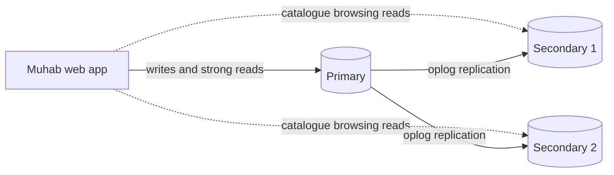

# Portfolio 5: Distributed and Cloud Database – Muhab Gadget Store

**Student:** Abubakar Mubarak (301927457)

## 1. Practical setup: 3-node MongoDB replica set
A replica set named `rs0` was built in GitHub Codespaces with three `mongod` nodes on
ports 27018, 27019 and 27020, holding Muhab's product catalogue. Script:
`Abubakar_Mubarak_301927457_P5_ReplicaSetDemo.sh`. Output: `..._P5_ReplicaSetOutput.txt`.

| Step | Result |
|---|---|
| Initiate | localhost:27018 elected PRIMARY; 27019 and 27020 SECONDARY |
| Write (w: majority) | 3 products inserted, acknowledged by a majority of nodes |
| Read every node | products = 3 on all three nodes, so the data was replicated |
| Primary shut down | 27018 unreachable; 27019 elected PRIMARY |
| Write during outage | Accepted by 27019; products = 4 |
| Old primary restarted | 27018 rejoined as SECONDARY with products = 4 (caught up automatically) |
| Replication lag | 0 seconds on both secondaries |

## 2. Replication
The primary records every change in its **oplog** (operation log). Secondaries copy the
oplog and apply the same operations in order. This gives Muhab:
- **Redundancy:** a full copy of the data exists on three servers.
- **Read scaling:** catalogue browsing can be served from secondaries.
- **Automatic recovery:** a returning node replays what it missed, as 27018 did in step 7.

Replication is **not a backup**. An accidental `deleteMany` is replicated to every node
within milliseconds. Muhab still needs scheduled backups with point-in-time recovery.

## 3. Availability and failover
Three nodes is the minimum for automatic failover. Elections need a **majority (2 of 3)**,
so one node can fail and the set still elects a primary and accepts writes, as step 6
showed. With only two nodes, losing one leaves 1 of 2, which is not a majority, so the
set becomes read-only.

The new primary was elected in about 0 seconds because the shutdown was clean: the
primary stepped down and handed over to an up-to-date secondary (election handoff). In a
real crash or network loss, the secondaries would first wait for the election timeout
(10 seconds by default). Customers would see a short pause in writes, not a failure.

## 4. Consistency
- **Write concern `w: "majority"`** (used in the demo): the write is acknowledged only once
  most nodes have it, so it cannot be lost if the primary then fails. `w: 1` is faster but
  a write acknowledged only by a failed primary can be rolled back.
- **Reads from secondaries are eventually consistent.** They may be milliseconds behind
  the primary. That is acceptable for browsing the catalogue (a price shown a moment late),
  but **not** for stock or payments, which must read from the primary.
- **CAP theorem:** during a network partition a system must choose between consistency and
  availability. With majority writes, MongoDB chooses **consistency**: a minority side
  cannot accept writes. This is the right choice for Muhab, because accepting orders on
  two disconnected sides could sell the same phone twice, which is the distributed version
  of the lost update in Portfolio 3.

## 5. Sharding design (for future growth)
Sharding splits data across several replica sets when one server can no longer hold it or
handle its writes. Muhab does not need it yet (16 products, about 50,000 orders), but the
design should be ready:

| Data | Shard key | Reason |
|---|---|---|
| Carts (MongoDB) | hashed `_id` (cart:customer:id) | Spreads carts evenly; each lookup goes to one shard |
| Product catalogue (MongoDB) | none | Small, read-heavy; replication is enough |
| Order history (if moved to a distributed store) | hashed `customer_id` | A customer's orders stay together (fast history, query A in Portfolio 2) and load spreads evenly |

A **bad** shard key would be `order_date`. New orders always have the latest date, so every
write would hit the same shard (a hotspot), while the other shards sit idle.

For PostgreSQL, the first step would be **partitioning** `orders` by month
(`PARTITION BY RANGE (order_date)`), so old months can be archived and date-range reports
read fewer rows. Distributing it across servers (for example with the Citus extension, by
`customer_id`) would only be needed at much larger scale.

## 6. Cloud deployment
| Component | Deployment | Purpose |
|---|---|---|
| PostgreSQL (orders, stock, payments) | Managed service (e.g. AWS RDS or Azure Database for PostgreSQL) with a standby in a second availability zone | Automatic failover, backups, point-in-time recovery |
| PostgreSQL read replica | One replica | Runs heavy reports (Portfolio 2 Q2–Q4) without slowing checkout |
| MongoDB (catalogue, carts) | Managed replica set (e.g. MongoDB Atlas), one node in each of 3 availability zones | Survives the loss of a whole data centre |

Further considerations:
- **Region:** choose the region closest to Muhab's customers to keep latency low.
- **Data protection:** customer names, phone numbers and addresses are personal data. They should be stored and processed in line with the Nigeria Data Protection Act 2023, encrypted at rest and in transit, with access restricted by role.
- **Cost:** managed services cost more than self-hosting, but remove the need to run failover, patching and backups manually, which suits a small business.
- **Monitoring:** alert on replication lag, failed elections, disk usage and slow queries.

## 7. Summary
The demo showed that a three-node replica set keeps Muhab's catalogue available through
the loss of its primary, with no lost writes, and recovers automatically. Combined with
majority writes, primary reads for stock, a managed multi-zone cloud deployment and a
future customer-based shard key, this design lets Muhab grow without giving up the
consistency that its orders and stock require.